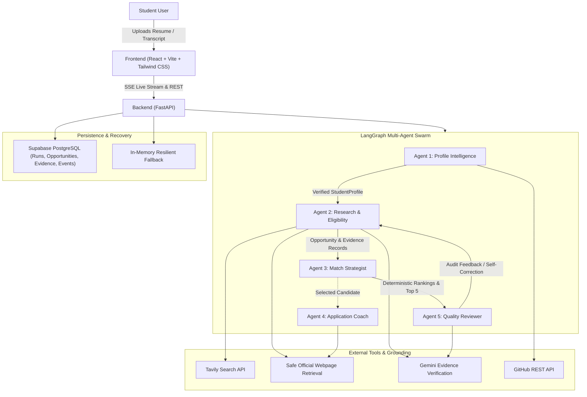

# ScholarSwarm 🎓
### Multi-Agent International Academic Scholarship Intelligence Engine
**TetraNoodle AI Hackathon 2026**

ScholarSwarm replaces generic search portals and hallucinating chatbots with an evidence-first, multi-agent research assistant. Five specialized AI agent roles coordinated through LangGraph read student academic credentials, discover genuine degree programs and funding opportunities using Tavily Search plus safe official webpage retrieval, evaluate admissions policies against official university domains, calculate transparent deterministic match scores, and generate grounded Statements of Purpose (SOP).

---

## 🌟 Key Features

1. **5 Collaborating AI Agent Roles**:
   - **Profile Intelligence Agent**: Extracts credentials locally from PDF/DOCX resumes and transcripts; enriches profile with public GitHub repositories.
   - **Research & Eligibility Agent**: Conducts live Tavily Search discovery across Canada, Germany, and Singapore, then validates official requirements through safe webpage retrieval and evidence checks.
   - **Match Strategist Agent**: Calculates deterministic 0-100 fit scores with hard eligibility disqualifier filters.
   - **Application Coach Agent**: Operates on-demand when a user selects a matched candidate to draft a tailored, editable Statement of Purpose without inventing accomplishments.
   - **Quality Reviewer Agent**: Adversarially challenges evidence, verifies source domains, and triggers bounded self-correction loops.
2. **Criterion-Level Evidence Auditing**:
   - Stated university policy, student metric comparison, official URL citation, and check timestamp recorded for every criterion.
   - Core statuses: `MEETS_STATED_CRITERIA`, `POTENTIAL_MATCH`, `DOES_NOT_MEET`, `INSUFFICIENT_EVIDENCE`.
3. **Live Server-Sent Events (SSE)**:
   - Streams real execution events from LangGraph to the frontend in real-time with sequence-based replay.
4. **Deterministic Match Scoring**:
   - Transparent Python calculation: Academic Fit (35%), Funding (25%), Subject Fit (20%), Deadline (10%), Evidence Quality (10%).
5. **Eligibility Gap Planner & SOP Generator**:
   - Pinpoints unresolved criteria and produces editable SOPs with explicit unconfirmed claim warnings.
6. **Free-Tier-First Deployment**:
   - Frontend on Cloudflare Pages, Backend on Render, Persistent Storage on Supabase PostgreSQL.

---

## 🏛️ System Architecture



---

## 🚀 Quick Start & Local Setup

### Prerequisites
- Python 3.11+ (Tested on Python 3.13)
- Node.js 18+ (Tested on v22)
- Git

### 1. Clone & Configure Environment
```bash
git clone https://github.com/Piyush01singh/Agent_Swarm_Case_Study.git
cd Agent_Swarm_Case_Study

# Copy environment template
cp .env.example .env
```

Set the following in `.env`:
```dotenv
GEMINI_API_KEY=your_gemini_api_key_here
GEMINI_MODEL=gemini-3.1-flash-lite
TAVILY_API_KEY=your_tavily_api_key_here
TAVILY_SEARCH_DEPTH=basic
TAVILY_MAX_RESULTS=5
GITHUB_TOKEN=your_optional_github_token
SUPABASE_URL=your_supabase_url_here
SUPABASE_SERVICE_ROLE_KEY=your_supabase_key_here
FRONTEND_ORIGIN=http://localhost:5173
VITE_API_BASE_URL=http://localhost:8000
```
*(Note: If `GEMINI_API_KEY`, `TAVILY_API_KEY`, or `SUPABASE_URL` is omitted, ScholarSwarm operates seamlessly in resilient local evaluation mode using in-memory storage and verified benchmark academic opportunities).*

---

### 2. Start the Backend (FastAPI + LangGraph)
#### Windows PowerShell:
```powershell
cd backend
python -m pip install -r requirements.txt
uvicorn app.main:app --host 0.0.0.0 --port 8000 --reload
```
#### macOS / Linux:
```bash
cd backend
pip install -r requirements.txt
uvicorn app.main:app --host 0.0.0.0 --port 8000 --reload
```
The backend API will be live at `http://localhost:8000` (Interactive Swagger docs: `http://localhost:8000/docs`).

---

### 3. Start the Frontend (React + Vite + Tailwind CSS)
In a new terminal:
```bash
cd frontend
npm install
npm run dev
```
Open `http://localhost:5173` in your browser.

---

## 🧪 Automated Testing

ScholarSwarm includes a 21-test automated suite testing models, document parsers, scoring logic, SSRF sanitizers, LangGraph workflows, and API adaptability:

```bash
cd backend
python -m pytest tests -v
```
**Test Results**: `286 passed` offline with 100% pass rate.

*Note on Performance Benchmarks*: The empirical evaluation harness (`backend/scripts/evaluate_harness.py`) executes in deterministic simulated benchmark mode to provide reproducible, offline verification of agent routing, classification accuracy, and fault recovery without consuming personal Gemini API quota.

To verify the production frontend build:
```bash
cd frontend
npm run build
```
Builds cleanly into `frontend/dist/` in under 9 seconds.

---

## 🚢 Deployment Guide

### 1. Database: Supabase PostgreSQL
1. Create a free project at [supabase.com](https://supabase.com).
2. Open the SQL Editor in Supabase.
3. Paste and run the contents of [`supabase/schema.sql`](supabase/schema.sql).
4. Copy your `Project URL` and `service_role` secret key into your Render environment variables.

### 2. Backend: Render Free Web Service
- **Build Command**: `pip install -r requirements.txt`
- **Start Command**: `uvicorn app.main:app --host 0.0.0.0 --port $PORT`
- **Root Directory**: `backend`
- **Environment Variables**:
  - `GEMINI_API_KEY`: your Google Gemini API key
  - `GEMINI_MODEL`: `gemini-2.5-flash`
  - `SUPABASE_URL`: your Supabase project URL
  - `SUPABASE_SERVICE_ROLE_KEY`: your Supabase service role key
  - `FRONTEND_ORIGIN`: URL of your Cloudflare Pages deployment

### 3. Frontend: Cloudflare Pages
- **Root Directory**: `frontend`
- **Build Command**: `npm ci && npm run build`
- **Build Output Directory**: `dist`
- **Environment Variables**:
  - `VITE_API_BASE_URL`: your Render backend URL (e.g. `https://scholarswarm-api.onrender.com`)

---

## 🛡️ Security, Privacy & Free-Tier Disclosures

- **Data Privacy**: Uploaded resumes and marksheets are parsed in-memory locally. Raw documents are never permanently stored or shared with external third-party search vendors.
- **SSRF Protection**: All discovered candidate URLs undergo strict validation against private, loopback, and link-local IP blocks before inspection.
- **Render Cold Starts**: Render's free tier spins down idle services. ScholarSwarm's frontend includes graceful reconnect polling to prevent false failure states during cold starts.
- **No Automatic Submissions**: ScholarSwarm strictly assists application preparation; it never automatically submits university applications on behalf of students.

---

## 📚 Deliverables & Documentation Index

- [Architecture & Design Details](docs/ARCHITECTURE.md)
- [Self-Correction Empirical Experiment (Deterministic Simulated Benchmarks)](docs/EXPERIMENT.md)
- [Real Engineering Challenges & Debugging](docs/CHALLENGES.md)
- [Interview & Defense Q&A (20 Questions)](docs/INTERVIEW_PREP.md)
- [5-Minute Hackathon Demonstration Script](docs/DEMO_SCRIPT.md)
- [Supabase PostgreSQL Schema](supabase/schema.sql)

---

**Developed for the TetraNoodle AI Hackathon 2026**
