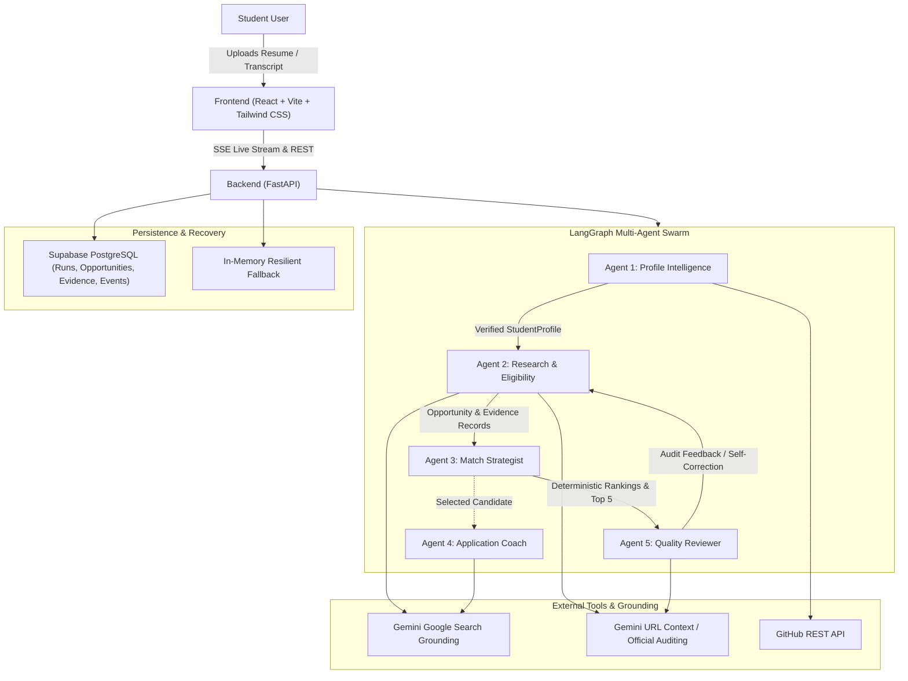
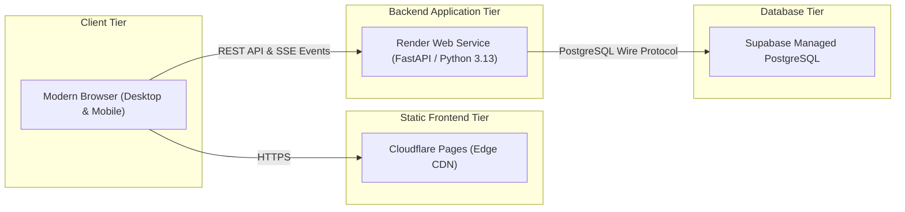

# ScholarSwarm Architecture & Technical Design
## TetraNoodle AI Hackathon 2026

ScholarSwarm is an evidence-first, multi-agent academic scholarship research and application assistance system. It replaces fragmented scholarship search portals with five coordinating AI agent roles orchestrated deterministically through LangGraph.

---

## 1. System Architecture Diagram

---

## 2. Deployment Architecture Diagram

---

## 3. The Five Agent Roles and Division of Labor

ScholarSwarm uses **exactly five named agent roles** executing specific responsibilities. The LangGraph supervisor is workflow orchestration, not a sixth agent.

| Agent Role | Responsibility | Input | Output | AI vs. Deterministic |
|---|---|---|---|---|
| **1. Profile Intelligence Agent** | Parses PDF/DOCX resumes and marksheet transcripts locally, retrieves public GitHub repositories to verify AI/ML experience, and detects conflicting facts. | Document text, form data, GitHub handle | `StudentProfile` Pydantic model | Hybrid (Local regex/PyMuPDF + GitHub REST API) |
| **2. Research & Eligibility Agent** | Discovers genuine programs via Gemini Google Search grounding, examines official URLs, and determines criterion-level admission/scholarship eligibility. | Profile facts, target countries, intake | Candidate opportunities, `EvidenceRecord`s | AI (Gemini Search & URL Context) |
| **3. Match Strategist Agent** | Evaluates hard mandatory eligibility disqualifiers, calculates multidimensional match scores (0-100), and shortlists top 5 opportunities. | Verified opportunities & profile | Scored opportunities & Top-5 flags | **100% Deterministic Python** |
| **4. Application Coach Agent** | Synthesizes verified student projects and skills with official program focus to produce an editable Statement of Purpose (SOP) without inventing accomplishments. | Selected opportunity & profile | `ApplicationDraft` with unconfirmed flags | AI (Constrained LLM Prompt) |
| **5. Quality Reviewer Agent** | Independently audits evidence citations, flags secondary sources, detects ambiguous deadlines, and triggers targeted re-research loops. | Scored opportunities & evidence | Review status, audit issues, retry trigger | AI + Deterministic Rule Auditing |

> **Note on Agent 4 (Application Coach) Execution Model**:
> Agent 4 operates as an **on-demand application specialist** invoked selectively via the REST endpoint `POST /api/opportunities/{id}/sop` when the student chooses a specific matched opportunity from their top recommendations. It does not run as an autonomous looping node inside the core LangGraph research discovery loop (`Profile Intelligence -> Research Discovery -> Match Strategist -> Quality Reviewer`). This intentional architectural separation eliminates speculative LLM token consumption and latency overhead across unranked or rejected candidates.

---

## 4. Deterministic Code vs. AI Components

To eliminate hallucinations and ensure algorithmic transparency:

1. **Scoring Logic**: Match scores are calculated using regular Python arithmetic, not LLM opinions.
   - Academic & Eligibility Fit: **35 pts**
   - Funding Coverage & Suitability: **25 pts**
   - Subject & Program Fit: **20 pts**
   - Deadline & Application Readiness: **10 pts**
   - Evidence Quality & Freshness: **10 pts**
   - Total: **100 pts**
2. **Hard Disqualifiers**: Any candidate failing a mandatory stated requirement (`DOES_NOT_MEET`) is strictly filtered out of the top-five shortlist by code.
3. **SSRF & Security Sanitizer**: All external URLs discovered by search grounding are validated against private network IP blocks, loopback addresses, and link-local ranges before retrieval.
4. **URL Normalization**: Canonical URLs are normalized to eliminate duplicate entries across search rounds.

---

## 5. Failure Recovery & Self-Correction

- **Bounded Re-Research Loop**: The conditional edge in LangGraph between Agent 5 and Agent 2 runs for a maximum of 2 rounds, guaranteeing workflow termination.
- **Server Sleep Recovery**: Render free tier web services spin down after inactivity. The frontend displays explicit connecting states and re-queries run status without failing prematurely.
- **SSE Stream Replay**: All agent events are stored with sequence numbers, allowing reconnecting clients to replay missed events seamlessly.
